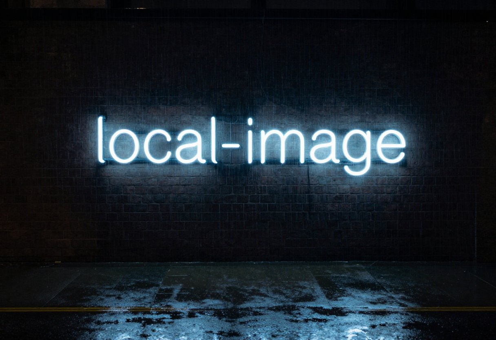
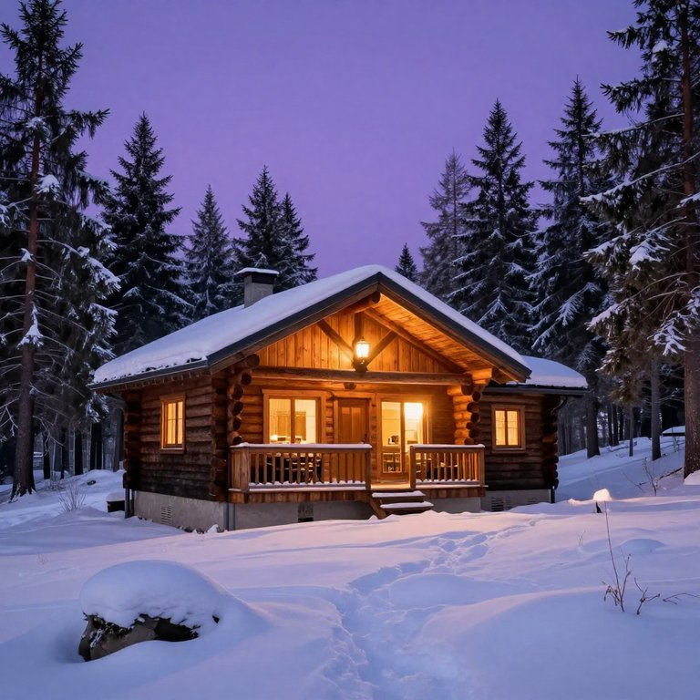
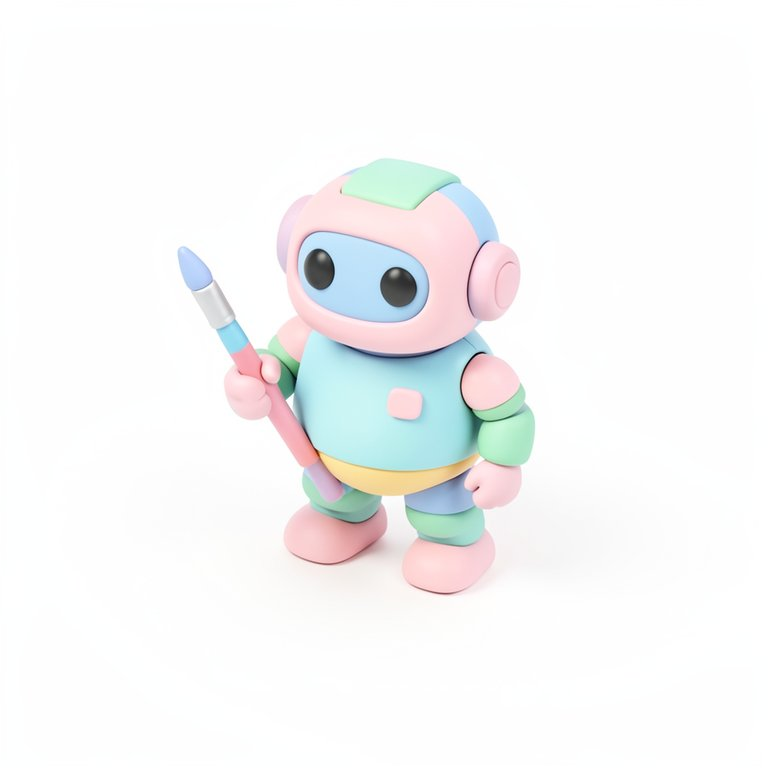
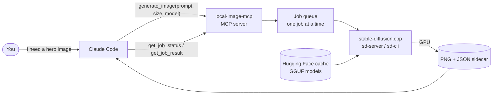

<div align="center">



# local-image-mcp

**Claude writes the prompt. Your GPU draws the image.**

Generate and edit images from Claude Code with open models that run on your own GPU.
No cloud, no API key, no cost per image.

[](https://github.com/fedeveloper/local-image-mcp/actions/workflows/ci.yml)
[](LICENSE)
[](pyproject.toml)
[](https://modelcontextprotocol.io)


[Quick start](#quick-start) · [Gallery](#gallery) · [How it works](#how-it-works) ·
[Use it from Claude Code](#use-it-from-claude-code) · [Configuration](#configuration) · [Docs](docs/)

</div>

---

## What it is

`local-image-mcp` connects [Claude Code](https://code.claude.com) (and any other
[MCP](https://modelcontextprotocol.io) client) to image models that run on your computer.

- **Claude does the thinking.** It reads your project, decides which images are needed,
  writes a good prompt, picks the size and saves the file in the right folder.
- **Your GPU does the pixels.** The server runs open models through
  [stable-diffusion.cpp](https://github.com/leejet/stable-diffusion.cpp), from GGUF files
  in your Hugging Face cache.

You ask *"add a hero image to the landing page"*. A few seconds later the PNG is in
`public/images/`, and the page uses it.

## Why use it

| | |
|---|---|
| 🔒 **Private** | Prompts, reference images and results stay on your computer. |
| 💸 **Free to run** | No subscription and no cost per image. Generate 500 variants if you want. |
| 🎮 **Runs on an 8 GB GPU** | Tested on an RTX 5060 8 GB laptop: a 1024×1024 image in about 14–22 s. |
| 🖼️ **Text to image and edits** | Two ready models. FLUX.2 klein edits an image from up to 4 references. |
| 🔁 **Reproducible** | Every PNG has a JSON sidecar with all settings. `local-image regenerate` makes it again. |
| ⏱️ **No timeouts** | Generation runs in a background job. Each MCP call returns in less than a minute. |
| 🧠 **Prompt skill included** | A Claude Code skill teaches Claude the workflow, the sizes and how to write prompts. |
| 🛠️ **Command line too** | `local-image generate` works without Claude, for scripts and tests. |

## Gallery

All images below come from this tool, on a laptop with an RTX 5060 8 GB, with the default
settings. The prompts and seeds are in [docs/gallery.md](docs/gallery.md), so you can
generate the same images.

<table>
  <tr>
    <td></td>
    <td></td>
    <td></td>
  </tr>
  <tr>
    <td align="center"><sub>Z-Image-Turbo · photo</sub></td>
    <td align="center"><sub>Z-Image-Turbo · product shot</sub></td>
    <td align="center"><sub>FLUX.2 klein 4B · app icon</sub></td>
  </tr>
  <tr>
    <td></td>
    <td></td>
    <td></td>
  </tr>
  <tr>
    <td align="center"><sub>FLUX.2 klein 4B · illustration</sub></td>
    <td align="center"><sub>FLUX.2 klein 4B · original</sub></td>
    <td align="center"><sub>FLUX.2 klein 4B · <b>edit</b> of the fox: "make it night, with northern lights"</sub></td>
  </tr>
</table>

## How it works



1. Claude calls `generate_image`. The server checks the request and queues a job. It
   returns a `job_id` at once.
2. The job runs on your GPU through stable-diffusion.cpp. With `sd-server`, the model
   stays loaded between images, so the next images are faster.
3. Claude waits with `get_job_status`, then calls `get_job_result`. It gets the file path,
   the settings and, if it asks, a small preview to check the result.
4. The PNG and its JSON sidecar are in your project. Claude can now use them in the code.

The server has five tools:

| Tool | What it does |
|---|---|
| `list_models` | Lists the models, their capabilities, limits and if their files are in the cache. |
| `generate_image` | Queues one image (text to image, or edit with reference images). Returns a `job_id`. |
| `get_job_status` | Returns the state and the progress. It can wait up to 45 s for the end. |
| `get_job_result` | Returns the image path, the sidecar path, the settings and an optional preview. |
| `cancel_job` | Cancels a queued or running job. |

## Models

| Model id | Model | What it can do | Steps | Time, 1024² | VRAM | Weights license |
|---|---|---|---|---|---|---|
| `z-image-turbo` | [Z-Image-Turbo](https://huggingface.co/Tongyi-MAI/Z-Image-Turbo) (GGUF) | text to image; good at photos and text in images | 8 | ~22 s (~14 s warm) | ~5.3 GB | Apache-2.0 |
| `flux2-klein-4b` | [FLUX.2 klein 4B](https://huggingface.co/black-forest-labs/FLUX.2-klein-4B) (GGUF) | text to image, edit, up to 4 reference images | 4 | ~22 s | ~3.6 GB (~4.6 GB with a reference) | Apache-2.0 |

Measured on Windows 11, RTX 5060 8 GB, with the text encoder on the CPU. "Warm" means
that `sd-server` already had the model in memory. You can use other quantizations
(Q4_K_M, Q5_K_M, Q8_0, ...) or add your own models: see [docs/models.md](docs/models.md).

## Quick start

You need:

- Windows 11 or Linux, with an NVIDIA GPU (8 GB VRAM or more) and a recent driver.
- [uv](https://docs.astral.sh/uv/). It installs Python 3.12 for you.
- About 25 GB of free disk space for the two models.
- [Claude Code](https://code.claude.com), for the MCP part.

### 1. Install stable-diffusion.cpp

<details open>
<summary><b>Windows 11</b></summary>

1. Open the [stable-diffusion.cpp releases](https://github.com/leejet/stable-diffusion.cpp/releases).
2. Download the archive for Windows, CUDA 12, x64.
3. Extract it, for example to `C:\tools\sdcpp\`. The folder contains `sd-cli.exe` and
   `sd-server.exe`.

</details>

<details>
<summary><b>Linux</b></summary>

```sh
git clone --recursive https://github.com/leejet/stable-diffusion.cpp
cd stable-diffusion.cpp
cmake -B build -DSD_CUDA=ON -DCMAKE_BUILD_TYPE=Release
cmake --build build --config Release -j
```

The programs are in `build/bin/`. You can also use a release archive.

</details>

More details and troubleshooting: [docs/backends/sdcpp.md](docs/backends/sdcpp.md).

### 2. Install local-image-mcp

<details open>
<summary><b>Windows 11 (PowerShell)</b></summary>

```powershell
# Install uv
powershell -ExecutionPolicy ByPass -c "irm https://astral.sh/uv/install.ps1 | iex"

# Get the code
git clone https://github.com/fedeveloper/local-image-mcp
cd local-image-mcp
uv sync

# Tell the tool where sd-cli is (for your user), then open a new terminal
[Environment]::SetEnvironmentVariable("LOCAL_IMAGE_SD_BINARY", "C:\tools\sdcpp\sd-cli.exe", "User")
```

</details>

<details>
<summary><b>Linux</b></summary>

```sh
# Install uv
curl -LsSf https://astral.sh/uv/install.sh | sh

# Get the code
git clone https://github.com/fedeveloper/local-image-mcp
cd local-image-mcp
uv sync

# Tell the tool where sd-cli is (add this line to ~/.bashrc)
export LOCAL_IMAGE_SD_BINARY=$HOME/stable-diffusion.cpp/build/bin/sd-cli
```

</details>

Then check the setup:

```sh
uv run local-image doctor
```

`doctor` shows the `sd-cli` version, the mode (`server` or `cli`), the Hugging Face
cache and the registry file.

### 3. Get a model

```sh
uv run local-image models check                # what is already in your cache
uv run local-image models pull z-image-turbo   # download only the missing files
```

The tool uses `HF_HOME` and `HF_HUB_CACHE`. If you already have some of the files, it
uses them and does not download a second copy. The MCP server never downloads anything:
only `models pull` does.

### 4. Generate your first image

```sh
uv run local-image generate -m z-image-turbo --seed 42 \
  -p "A red fox in fresh snow at sunrise, soft warm light, photorealistic"
```

The PNG and its JSON sidecar go to `generated-images/`.

## Use it from Claude Code

### 1. Register the server

<details open>
<summary><b>Windows (PowerShell)</b></summary>

```powershell
claude.exe mcp add --transport stdio --scope user local-image `
  -e LOCAL_IMAGE_SD_BINARY=C:\tools\sdcpp\sd-cli.exe `
  -- uv run --directory C:\path\to\local-image-mcp local-image-mcp
```

NOTE: In Windows PowerShell 5.1, call `claude.exe`, not `claude`. Put the server name
(`local-image`) before `-e`.

</details>

<details>
<summary><b>Linux</b></summary>

```sh
claude mcp add --transport stdio --scope user local-image \
  -e LOCAL_IMAGE_SD_BINARY=$HOME/stable-diffusion.cpp/build/bin/sd-cli \
  -- uv run --directory /path/to/local-image-mcp local-image-mcp
```

</details>

### 2. Install the skill

```sh
uv run local-image claude install-skill
```

The skill teaches Claude when to generate an image, which model to choose, how to write
prompts and edit instructions, and the common sizes.

### 3. Ask for images

Start a new Claude Code session and run `/mcp`: `local-image` must show as connected.
Then ask in plain words:

> *"Create a 1216×832 hero image of a mountain cabin at dusk and save it as
> public/images/hero.png."*

> *"Make three icon variants for the settings page, in the same style as
> assets/icons/home.png."*

> *"Take docs/screenshot-bg.png and make the sky darker."*

Claude writes the prompt, starts the job, waits, checks the preview and uses the file.
By default the images go to `<project>/generated-images/`.

TIP: Run `uv run local-image claude claude-md` to print a section for your project's
`CLAUDE.md`, with your asset folder, sizes and style. Full guide:
[docs/claude-code.md](docs/claude-code.md).

### Other MCP clients

The server is a standard MCP server over stdio. Any client that can start a command can
use it: run `uv run --directory /path/to/local-image-mcp local-image-mcp`.

## Configuration

All settings are environment variables. All of them are optional, except
`LOCAL_IMAGE_SD_BINARY` when `sd-cli` is not on your `PATH`.

| Variable | What it does | Default |
|---|---|---|
| `LOCAL_IMAGE_SD_BINARY` | Path of `sd-cli`. | `sd-cli` on `PATH` |
| `LOCAL_IMAGE_SD_MODE` | `auto`, `server` or `cli`. Server mode keeps the model loaded between images. | `auto` (server if `sd-server` is found) |
| `LOCAL_IMAGE_SD_SERVER_BINARY` | Path of `sd-server`. | next to `sd-cli`, else `PATH` |
| `LOCAL_IMAGE_SD_SERVER_IDLE` | Seconds to keep the model loaded after the last job. `0` frees the GPU at once. | `120` |
| `LOCAL_IMAGE_QUANT` | Preferred quantization, for example `Q8_0`. | first file found in the cache |
| `LOCAL_IMAGE_REGISTRY` | Your own model registry (YAML). | user config folder |
| `LOCAL_IMAGE_OUTPUT_DIR` | Default output folder. | `<project>/generated-images` |
| `LOCAL_IMAGE_ALLOWED_ROOTS` | Extra folders where the server can write images (`;` on Windows, `:` on Linux). | the project folder |
| `LOCAL_IMAGE_STATE_DIR` | Jobs, GPU lock and backend logs. | `%LOCALAPPDATA%\local-image-mcp` or `~/.local/state/local-image-mcp` |
| `LOCAL_IMAGE_LOG_LEVEL` | Log level on stderr. | `WARNING` |
| `HF_HOME`, `HF_HUB_CACHE` | Hugging Face cache location. | Hugging Face default |

For Claude Code, pass a variable with `-e NAME=value` in `claude mcp add`.

## Command line

| Command | What it does |
|---|---|
| `local-image doctor` | Shows the configuration, the `sd-cli` version and the cache. |
| `local-image models list` | Lists the models, with capabilities and license. |
| `local-image models check` | Shows which model files are in the cache. |
| `local-image models pull <model> [--quant Q8_0]` | Downloads the missing files of a model. |
| `local-image models init-registry` | Creates your user registry file, with an example. |
| `local-image generate -m <model> -p "<prompt>"` | Generates one image (`--seed`, `-W`, `-H`, `--steps`, `--ref`, `-o`). |
| `local-image regenerate <image>.json` | Generates an image again from its sidecar. |
| `local-image claude install-skill` | Installs the Claude Code skill. |
| `local-image claude claude-md` | Prints a section for your project's `CLAUDE.md`. |

## FAQ

<details>
<summary><b>Do I need an Anthropic API key for the images?</b></summary>

No. Claude Code uses your normal Claude account for the reasoning. The images come from
your GPU, at no extra cost.

</details>

<details>
<summary><b>Does it work without an NVIDIA GPU?</b></summary>

The tested setup is an NVIDIA GPU with CUDA. stable-diffusion.cpp also has Vulkan, Metal
and CPU builds. They can work if you point `LOCAL_IMAGE_SD_BINARY` to them, but we do
not test them yet. Reports are welcome.

</details>

<details>
<summary><b>Can I use my own models or quantizations?</b></summary>

Yes. Set `LOCAL_IMAGE_QUANT` for another quantization. Run
`local-image models init-registry` to add other files or other models. See
[docs/models.md](docs/models.md).

</details>

<details>
<summary><b>On Windows, <code>uv sync</code> fails with "access denied".</b></summary>

A running Claude Code session keeps the `local-image` MCP server open, and Windows locks
`local-image-mcp.exe`. Close the Claude Code sessions, then run `uv sync` again.

</details>

## Model licenses

**The license of this code (Apache-2.0) does not cover the models.** Each model has its
own license. `local-image models list` and the `list_models` tool show it. Read it before
you use the images, above all for commercial use. For example, FLUX.2 klein **9B** and
FLUX.2 dev use a **non-commercial** license. For this reason they are not in the built-in
registry.

## Responsible use

- **Do not generate images of real, identifiable people without their consent.** This
  includes public figures, colleagues, friends and family.
- Do not create images that deceive (fake evidence, fake news photos, fake documents),
  that harass, or that sexualize anyone. Never create sexual content that involves minors.
- Label generated images as AI-generated when people can take them for real photos.
- Respect copyright and trademarks in prompts and in reference images.
- Follow the license and the use policy of each model.

The skill for Claude Code contains the same rules.

## Status and roadmap

**Release candidate (0.1.0rc1).** Windows 11 is the main platform. Linux works and runs
in CI. See [CHANGELOG.md](CHANGELOG.md) for the changes and [PLAN.md](PLAN.md) for the
design.

## Contributing

Issues and pull requests are welcome. The tests use a `fake` backend and need no GPU:

```sh
uv sync
uv run ruff check . && uv run ruff format --check . && uv run pyright && uv run pytest
```

See [CONTRIBUTING.md](CONTRIBUTING.md).

## Acknowledgements

- [stable-diffusion.cpp](https://github.com/leejet/stable-diffusion.cpp) by leejet and
  contributors, the inference engine.
- [Z-Image](https://huggingface.co/Tongyi-MAI/Z-Image-Turbo) by Tongyi-MAI and
  [FLUX.2 klein](https://huggingface.co/black-forest-labs/FLUX.2-klein-4B) by Black Forest Labs.
- [unsloth](https://huggingface.co/unsloth) and [Comfy-Org](https://huggingface.co/Comfy-Org)
  for the GGUF and VAE files.
- The [Model Context Protocol](https://modelcontextprotocol.io).

## License

Apache-2.0. See [LICENSE](LICENSE).
